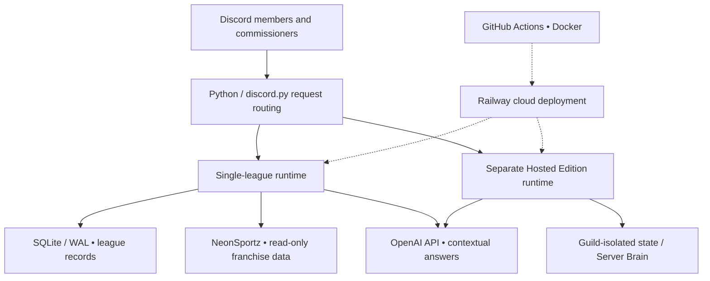

# CoachNoChill AI
### AI-powered Discord automation • Cloud deployment • Real-world league operations

**An independently engineered AI assistant and operations platform built for a live, 32-team Madden NFL franchise community.**

CoachNoChill AI combines Python application development, conversational AI, third-party APIs, persistent data, and operational automation to help a league commissioner manage scheduling, owner communication, weekly awards, and day-to-day workflows. This project grew from a league-specific Discord bot into a broader architecture with a separate multi-server *Hosted Edition* code path.

> **Portfolio showcase only.** The live application's source repository, deployment settings, tokens, and member data are private. This public repository shares selected design decisions and sanitized examples—not production credentials or a runnable clone.

**Built by:** Dominique Minor · Independent software and AI project · **Started:** August 2026 · **Status:** Ongoing development

## At a glance

| Focus | What I built / practiced |
|---|---|
| AI & backend | Python, `discord.py`, OpenAI API, contextual question routing, asynchronous workflows |
| Data & integrations | SQLite / WAL, structured league records, read-only NeonSportz/Madden data integration, REST APIs |
| Cloud & DevOps | Railway, Docker, GitHub, GitHub Actions, release validation and troubleshooting |
| Reliability | Backups and restore checks, data integrity checks, retry/backoff, runtime health diagnostics |
| Governance | Role-based access, approval-gated actions, privacy-conscious storage, tenant isolation in Hosted Edition |

## The problem

Running a fast-moving online league creates repetitive administrative work: reminding players of advance deadlines, helping owners find rules and schedules, reporting verified results, resolving missing information, and coordinating weekly awards. Manual processes are slow and error-prone, especially across time zones and multiple league weeks or seasons.

## My solution

I designed **CoachNoChill AI** as a Discord-native assistant that brings league information and administrative tools into the place members already communicate. It pairs AI explanations with structured data checks so the bot can be helpful **without treating an AI guess as an official league decision**.

### Selected capabilities

- **Conversational assistant:** Answers league questions in plain English with context and approved knowledge.
- **Schedule & deadline support:** Advance countdowns, reminders, matchup coordination, and availability workflows.
- **League intelligence:** Read-only access to structured schedules, standings, team and player information where integrated.
- **Weekly content:** Player of the Week (POTW), Game of the Week (GOTW), recaps, and commissioner-reviewed results.
- **Commissioner operations:** Dashboards, approvals, owner status, recruitment workflows, and documented decision support.
- **Hosted Edition design:** A separate multi-server application path with guild-scoped data, explicit knowledge, skill controls, and usage accounting. Some advanced skills are **opt-in** and deployment-dependent.

## System architecture

[Detailed architecture and trust boundaries](docs/ARCHITECTURE.md)

## Screenshots and demonstration

The production bot operates inside Discord. I am preparing **real, sanitized screenshots** of the following workflows before publishing them:

1. Natural-language question → grounded assistant answer.
2. Commissioner dashboard, scheduling, or advance-reminder experience.
3. Weekly award workflow (POTW/GOTW) or verified franchise information.
4. GitHub Actions / Railway deployment evidence with secrets and identifiers hidden.

**Screenshots will be added only after redacting private channels, usernames, Discord IDs, member messages, tokens, and account information.** [Screenshot checklist](screenshots/README.md)

## Engineering highlights

**Designed for the real world.** I worked through production behaviors such as Discord command synchronization, API throttling, state reconciliation after restarts, and multi-season record handling.

**Human in control.** AI can explain, recommend, and prepare evidence; sensitive actions such as league penalties, trades, and Force Wins remain subject to commissioner authority.

**Separation of concerns.** The live single-league deployment and the separate Hosted Edition application have different startup paths and storage boundaries to avoid mixing league data.

**Safe releases.** My workflow uses feature branches, pull requests, automated checks, Docker validation, and deployment verification. The private codebase includes regression tests around key safeguards.

[Project case study and lessons learned](docs/CASE_STUDY.md) · [Security and privacy notes](docs/SECURITY_AND_PRIVACY.md)

## Technologies

**Language:** Python  
**AI and messaging:** OpenAI API, Discord API / `discord.py`  
**Data:** SQLite, SQL, JSON  
**Integrations:** REST APIs, NeonSportz (read-only league data)  
**Delivery:** GitHub, GitHub Actions, Docker, Railway  
**Methods:** Async event handling, API integration, technical documentation, testing, incident troubleshooting

## What this project demonstrates

I can take a problem from real users, turn it into working software, integrate external services, deploy it to the cloud, and maintain it through changing requirements and production incidents. That experience is directly relevant to **application support, cloud support, software development, IT automation, and AI integration** roles.

## Source and contact

- **Source code:** Private; shared selectively only where appropriate.
- **Live demo:** Available by request, subject to league/member privacy.
- **LinkedIn:** [Dominique Minor](https://www.linkedin.com/in/dominique-minor-20393629b/)

*This is an independent portfolio case study. Madden, NFL, Discord, GitHub, OpenAI, and other names are the property of their respective owners. No affiliation or endorsement is implied.*