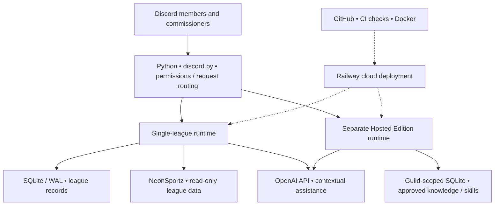

# CoachNoChill AI — Architecture and design decisions

This is a conceptual overview of the private application's design, **not** a runnable deployment recipe. Certain advanced capabilities are optional and deployment-dependent.

## High-level architecture

## Discord application layer

The user-facing experience includes slash commands, buttons, structured interactions, conversational assistance, and commissioner-facing dashboards. Requests are routed using command permissions and verified server/user context. The system distinguishes read-only help from protected actions needing human authorization.

## Separate application runtimes

| Application | Purpose | Isolation boundary |
|---|---|---|
| Single-league assistant | Madden franchise administration, scheduling, reminders, awards, game-day information, and commissioner support | Dedicated league configuration, service, and SQLite data |
| Hosted Edition | Separate multi-server assistant architecture using approved Server Brain knowledge, missions, skill controls, and usage accounting | Guild-scoped persistent data, separate service and startup path, explicit feature gates |

The Hosted Edition does **not** automatically import the single-league runtime or grant access to commissioner-only league operations. Its optional integrations and skills must be configured and validated before use.

## Information flow

1. A member asks a question or triggers a workflow within Discord.
2. Python validates the request context, permissions, and intended operation.
3. For factual league questions, structured records and deterministic rules are preferred.
4. Supported questions are answered with the OpenAI API using only approved available context, with uncertainty distinguished from verified results.
5. Relevant state and limited operational receipts are stored in the appropriate SQLite database.
6. Sensitive operations (for example, penalties, Force Wins, and trade rulings) remain under commissioner control.

External NeonSportz/Madden data is used for **read-only league lookup**, not unauthorized changes to the game.

## Cloud engineering and reliability

Source changes use feature branches, pull requests, automated tests, Docker validation, and release verification. Railway runs the application with persistent storage and environment-based configuration. Important engineering practices include:

- Startup SQLite integrity checks and backup/restore probes.
- Retry and backoff around provider failures and API rate limits.
- Discord command synchronization and gateway/login hardening.
- Restart reconciliation, protected data boundaries, and troubleshooting from logs.
- Regression testing before deployment.

## Design trade-offs

**Accuracy over plausible guesses:** A conversational model can summarize or advise, but verified records decide factual league state.

**Convenience with boundaries:** Members get simple commands and buttons; commissioner authority and server isolation are not bypassed.

**Operational reliability over feature count:** Persistent state, diagnostics, release tests, and recoverability matter for an application used by real people.

**Privacy by design:** This public repository does not include server/member identifiers, transcripts, provider secrets, production configuration, or source code.

[Back to project overview](../README.md)
